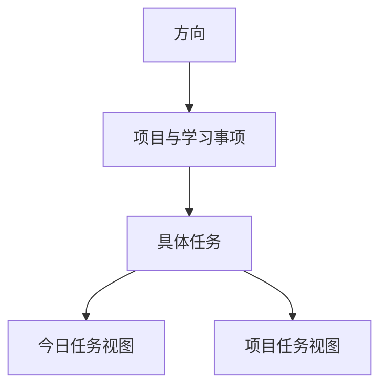

# 架构与数据设计

## 方向、项目和任务

方向用于长期分类，项目／学习事项记录持续推进的内容，任务是可以执行和勾选完成的一件事。方向自动汇总项目数量、任务总数、完成数和待办数；文字进度由使用者记录。



两个任务视图引用同一份Markdown数据。未设日期的任务保留在项目／方向下，不为进入今日视图补造日期。项目移到其他方向，所属任务在展示和统计中一起迁移。

## Obsidian 接入

`YuWorkbench`继承`Plugin`，注册`yu-workbench-home`视图、侧栏图标、命令和`obsidian://yu-workbench`协议。应用布局就绪后打开首页；读取与写入使用Obsidian Vault接口。打开锁防止重复创建视图，任务文件变化时刷新。

| 数据 | 保存位置 | 说明 |
| --- | --- | --- |
| 任务 | 工具/个人工作台/待办收件箱.md | Markdown复选框；只保存一份 |
| 方向与项目 | 插件目录/data.json | 稳定ID、名称、所属方向、阶段、下一步和链接 |
| 旧进度 | 工具/个人工作台/方向与进度.md | 首次加载兼容导入，保留原始字段 |
| 主题 | styles.css | 使用`.theme-light`和`.theme-dark`及语义颜色变量 |
| 同步状态 | Remindian本机配置与日志 | 工作台只读，不直接操作EventKit |

项目数据结构版本为3。迁移保留旧字段，不删除来源不明的旧学习事项。写入队列防止并发覆盖；任务编辑检测原文和备注变化，保留其他工具的同步标记。重复任务的完成操作交由Tasks处理，以免误生成下一次重复。

## 任务格式与内部元数据

```md
<!-- yu:example-task -->
- [ ] 完成示例阅读 #项目/example-project 📅 2030-01-02 14:30 ⏫
```

任务ID放在紧邻复选框之前的隐藏行，不放在任务标题中。工作台备注以编码后的`yu-note`注释放在同一隐藏行，避免同步工具把编号或备注当成提醒标题。

方向或项目标签仍用于工作台归类；Remindian设置关闭“write tags into reminder notes”。项目与任务ID只是内部关联标识，不应该出现在面向使用者的标题或备注中。

旧版行末`<!-- yu:... -->`仍可读取；迁移器把它移到独立隐藏行，并更新索引中的源任务键，保留原苹果提醒事项ID与两个同步基线。关联缺失、重名或格式不符合预期时拒绝迁移。

## 提醒事项接入


工作台不实现另一套EventKit同步引擎。Remindian负责系统权限、文件监听、定时同步、目标清单、冲突处理与回写。插件显示的日志状态只表示文件与日志的相对更新时间，不能证明每条提醒或闹钟已经送达。

当前 `📅 YYYY-MM-DD HH:mm` 是针对已验证Remindian版本的兼容写法，并非Obsidian Tasks通用标准；外部任务编辑器可能把时间去掉。

## 安装与恢复

安装必须显式指定知识库路径。默认只安装插件，只有`--enable-reminders`才处理所选Remindian配置。同步迁移要求来源、目标、清单、扫描范围与状态存储位置匹配；不会猜测安全书签或导入系统权限。

安装器先规划、比对原始字节、备份，再写入并校验。中途写入失败会恢复已经修改的文件；仅删除本次失败安装刚创建的文件，不删除原笔记。备份包含所修改文件的本地路径，因此也不能提交到仓库。
